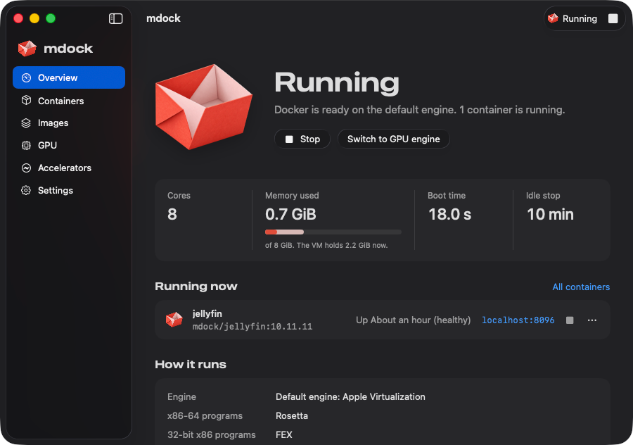
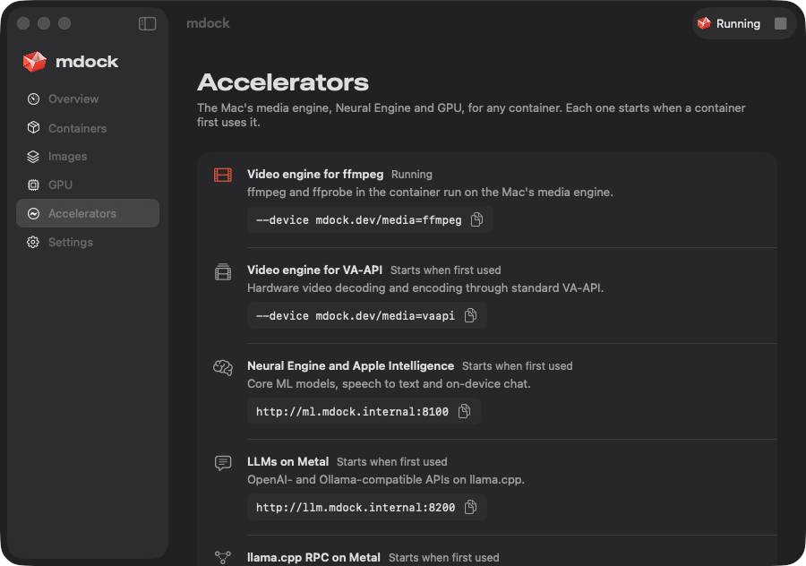

# mdock

**Docker for Apple silicon Macs, built from source.** mdock runs Docker Engine in a lightweight Linux
VM on Apple's Virtualization.framework and plugs into the regular `docker` command as a context, so
`docker`, `docker compose`, `docker buildx` and `kubectl` work as usual. It replaces Docker Desktop:
no account, no subscription and no closed-source components besides what ships with macOS.

On top of what Docker Desktop does, it can give containers the Mac's GPU, media engine and Neural
Engine, sync big source trees at native disk speed, and shut the VM down completely when you're not
using it.

> mdock is young and has been developed and tested on one Mac (M1, 16 GB, macOS 26.6). Expect rough
> edges. `mdock doctor` is the first stop when something isn't right.



## Why use it

Measured against Docker Desktop 4.37.2 on the same M1 ([full comparison](docs/comparison.md)):

- **Faster**: a cold start to `docker info` in 3.7 s (Docker Desktop: 6.9 s), `docker run` in 170 ms
  (260 ms), and published ports 10–24× faster.
- **Uses the whole Mac when you need it, and nothing when you don't**: all CPU cores, and with
  autostart on the VM stops after 10 idle minutes; your next docker command starts it again in about
  3.5 s.
- **x86 images** run through Rosetta. With mdock's own guest kernel, 32-bit ones run through FEX at
  2–5× QEMU's speed, and the CPU itself enforces x86's memory ordering ([how](docs/x86.md)).
- **The Mac's hardware in containers**: GPU (Vulkan, OpenGL, OpenCL), the media engine for video
  encoding, the Neural Engine, and LLMs on Metal.
- **Fast bind mounts** with `mdock sync`, a **case-sensitive workspace** volume, `host.docker.internal`
  and `--network host` that behave like they do on Linux, and optional single-node **Kubernetes**.

## Requirements

- A Mac with Apple silicon (M1 or later) and macOS 14 or later. The GPU engine needs macOS 26.
- Xcode Command Line Tools (Swift and git), Homebrew, and Rosetta.
- A few GB of free disk for the sources and builds, plus whatever your images need. The VM's disks
  are sparse files that only take up what the VM writes.

## Install

These steps take a while the first time: the Docker tools and the guest helper are compiled from
source.

**1. Install the prerequisites.**

```sh
xcode-select --install                                # Swift and git (skip if you have Xcode)
softwareupdate --install-rosetta --agree-to-license   # runs linux/amd64 images
brew install qemu e2fsprogs go                        # qemu-img and debugfs for the first start, Go for the docker CLI
```

**2. Get mdock, and put `~/.local/bin` on your PATH.** mdock and the Docker tools install there. It
must come before `/usr/local/bin`, where Docker Desktop puts its own `docker`.

```sh
git clone https://github.com/tariq-98/mdock.git ~/mdock
cd ~/mdock
echo 'export PATH="$HOME/.local/bin:$PATH"' >> ~/.zshrc
export PATH="$HOME/.local/bin:$PATH"
```

`mdock doctor`'s suggested fixes assume the repository lives at `~/mdock`.

**3. Build the Docker command-line tools.** This compiles `docker`, Compose, Buildx, the macOS
keychain credential helper, `kubectl` and Mutagen into `~/.local/bin`.

```sh
cli/build.sh
```

**4. Build and start mdock.**

```sh
./build.sh
mdock start
```

The first start downloads Alpine Linux (about 230 MB), creates the VM and installs Docker in it, which
takes a minute or two. It also creates the `mdock` docker context. Later starts take about 3 seconds.

Always build with `./build.sh`: it signs mdock with the entitlement macOS requires for running VMs. A
plain `swift build` produces an `mdock` that can't start the VM.

**5. Point `docker` at mdock.**

```sh
cli/configure.sh
```

This makes `mdock` the current docker context, stores registry logins in the macOS keychain (the same
entries Docker Desktop uses, so existing logins keep working), and uses the plugins from step 3. It
backs up `~/.docker/config.json`; `cli/configure.sh --revert` puts it back.

**6. Build the guest helper, then restart.** `guest/build.sh` compiles the helper that runs inside the
VM and provides file-change events for bind mounts, UDP ports and `host.docker.internal`, along with
FEX and QEMU for 32-bit x86 images. Everything compiles in containers on mdock itself.

```sh
guest/build.sh
mdock restart
```

**7. Start mdock at login.** Under launchd, mdock starts when you log in, restarts after a crash, and
stops the VM after 10 idle minutes (no containers running, no docker commands). The next docker
command starts it again.

```sh
mdock autostart on
mdock restart
```

**8. Check everything.**

```sh
mdock doctor
```

Each check prints `ok`, or the command that fixes it.

## Try it

```sh
docker run --rm hello-world
docker run -d --name web -p 8080:80 nginx                 # then open http://localhost:8080
docker rm -f web
docker run --rm --platform linux/amd64 alpine uname -m    # x86_64, through Rosetta
mdock status
```

## Day to day

- **Use docker as usual.** `mdock ps` and `mdock run …` work too (anything mdock doesn't know goes to
  docker), and so does `docker mdock status`.
- **Files**: bind-mount anything under `/Users`, `/Volumes`, `/private` or `/var/folders`; it has the
  same path inside the VM. Edits on the Mac reach file watchers in containers (vite, webpack, nodemon).
  For a big source tree, `mdock sync add ~/code/myapp` gives its bind mounts native disk speed (restart
  containers that already mount it).
- **Networking**: published ports and `--network host` listeners appear on the Mac's `localhost`.
  Inside containers, `host.docker.internal` is the Mac's own `localhost`.
- **Case-sensitive code**: `mdock workspace create` makes a case-sensitive volume at
  `/Volumes/Workspace` (`~/Workspace`). `mdock casecheck DIR` finds names that would collide on the
  Mac's normal, case-insensitive disk.
- **x86 images**: add `--platform linux/amd64` (or `linux/386`). `mdock arch-check IMAGE -- CMD` runs
  an image's arm64 and amd64 variants side by side and reports differences; `mdock port IMAGE`
  rebuilds an amd64-only image as native arm64.
- **Resources**: by default the VM gets every CPU core and half the RAM. Change it with, for example,
  `mdock set cpus=6 memory=6`, then `mdock restart`. `mdock set idle=0` turns idle stop off.
- **Stopping**: `mdock stop` shuts the VM down and keeps it down until `mdock start`. `mdock stop`,
  `mdock restart` and switching engines stop every running container.
- **Updating**: `git pull && ./build.sh && mdock restart` updates mdock; `mdock upgrade` updates the
  VM's packages and Docker Engine.

## Optional extras

| Feature | What you get | How |
|---|---|---|
| Hardware x86 memory order | FEX instead of QEMU for 32-bit x86 images on both engines and amd64 images on the GPU engine: 2–10× faster | `kernel/build.sh && mdock kernel install && mdock restart`; see [docs/x86.md](docs/x86.md) |
| GPU engine | Vulkan 1.2, OpenGL 2.1 / ES 2.0 and OpenCL in containers, on the Mac's GPU | build the GPU stack, then `mdock stop && mdock start --gpu`; see [docs/gpu.md](docs/gpu.md) |
| Media engine | Hardware video decode and encode for containers, through VA-API or ffmpeg (e.g. Jellyfin) | [accel/media](accel/media/README.md) |
| Neural Engine and speech | Core ML models, Whisper-style transcription, Apple Intelligence chat at `http://ml.mdock.internal:8100` | [accel/ml](accel/ml/README.md) |
| LLMs on Metal | OpenAI and Ollama APIs on llama.cpp at `http://llm.mdock.internal:8200` | [accel/llm](accel/llm/README.md) |
| Kubernetes | Single-node k3s in about 20 s; kubectl context `mdock`; images from `docker build` run in pods without a registry | `mdock kubernetes enable` (`disable` keeps the cluster, `reset` deletes it) |
| Desktop app | Menu-bar control and dashboard for the VM, containers, images and the GPU | `desktop/bundle.sh`; it also builds the GPU stack and the accelerators, which need the Homebrew packages listed in [docs/gpu.md](docs/gpu.md) and [accel/media](accel/media/README.md) |
| AI agents | An MCP server with 19 tools (run, build, logs, compose, kubectl, …) | `claude mcp add --scope user mdock -- ~/.local/bin/mdock mcp`; see [AGENTS.md](AGENTS.md) |

The accelerators are an open door between containers and your Mac: the media devices run ffmpeg on
the Mac as your user, and the ML and LLM endpoints answer every container. Only give the devices to
containers you trust.

The desktop app lists them with what a container passes to use each one:



## Two engines

`mdock start` uses Apple's Virtualization.framework; `mdock start --gpu` uses libkrun with a virtual
GPU. Both use the same disks, so images, containers and volumes are shared, and the choice is
remembered until you switch with `mdock stop && mdock start --gpu` or `--no-gpu`.

| | default engine | GPU engine |
|---|---|---|
| GPU in containers | no | Vulkan, OpenGL, OpenCL |
| linux/amd64 images | Rosetta | FEX with mdock's kernel, else QEMU; both start processes slower, so apt-heavy builds take longer |
| Networking | fastest | slower (userspace) |
| Memory | held until the VM stops; idle stop gives it back | returned to macOS within seconds |

## Coming from Docker Desktop

mdock and Docker Desktop can both stay installed, but don't run them at the same time: quit Docker
Desktop and turn off its "Start Docker Desktop when you sign in" setting. `cli/configure.sh` switches
the docker CLI to mdock and keeps your registry logins.

Images, containers and volumes don't carry over; pull or build them again. To copy an image while
Docker Desktop is still running:

```sh
docker --context desktop-linux save IMAGE | docker --context mdock load
```

To remove Docker Desktop for good, run `/Applications/Docker.app/Contents/MacOS/uninstall`, then
`sudo cli/default-socket.sh install`. That recreates `/var/run/docker.sock` at every boot, as Docker
Desktop's helper did, for tools that only look there.

## Commands

| Command | |
|---|---|
| `mdock start [--gpu\|--no-gpu]` / `stop` / `restart` | Boot the VM (about 3 s), shut it down, or both |
| `mdock status [--json]` | Engine, CPUs, memory, ports, translators, accelerators, Kubernetes |
| `mdock doctor [--json]` | Check everything mdock needs, with fixes; exit status 1 on failure |
| `mdock autostart on\|off` | Start at login, restart after a crash, stop when idle |
| `mdock set KEY=VALUE…` | `cpus`, `memory` (GiB), `disk` (GiB, grow only), `gpu`, `rosetta`, `aot`, `ports`, `balloon`, `sync`, `idle` (minutes; 0 = never); restart to apply, except `idle` |
| `mdock upgrade` | Update the VM's packages and Docker Engine, then restart |
| `mdock version [--json]` | Versions of mdock, the Docker CLI and engine, Compose, Buildx, kubectl, k3s |
| `mdock sync add [DIR] \| remove [DIR] \| list` | Native disk speed for a bind-mounted directory |
| `mdock workspace create [name] \| mount \| eject \| status` | Case-sensitive APFS volume for code |
| `mdock casecheck [DIR]` | Find names that differ only in case |
| `mdock arch-check [run options] IMAGE [-- CMD]` | Run an image on arm64 and amd64 side by side and compare |
| `mdock port IMAGE [--tag=NAME] [--replace]` | Rebuild an amd64-only image as native arm64 |
| `mdock kernel install [DIR] \| remove \| status` | mdock's guest kernel (hardware x86 memory order) |
| `mdock kubernetes enable\|disable\|reset\|status` | Single-node Kubernetes (`mdock k8s` for short) |
| `mdock gpu-check` | Show what GPU APIs a container gets (GPU engine) |
| `mdock mcp` | MCP server on stdio, for AI agents |
| `mdock shell` | Root shell inside the VM |
| `mdock debug CONTAINER [IMAGE]` | Shell beside a running container, even a distroless one: its network, processes and files, with Alpine's tools |
| `mdock logs [console]` | Follow mdock's log, or the VM's console |
| `mdock delete` | Delete the VM with all its images, containers and volumes |

## Troubleshooting

Start with `mdock doctor`. Beyond that:

- **`mdock: command not found`**: `~/.local/bin` isn't on your PATH (install step 2).
- **"Cannot connect to the Docker daemon"**: check `mdock status`, then `mdock start`. `docker context
  show` should print `mdock`; if not, `docker context use mdock`.
- **The VM won't start after a rebuild**: rebuild with `./build.sh`, not `swift build` (install step 4).
- **Docker Desktop was running**: quit it, then `mdock restart`.
- **An amd64 image misbehaves**: `mdock arch-check IMAGE -- CMD` compares it with its arm64 variant,
  and `mdock port IMAGE` builds a native one. If you turned on Rosetta's cache (`aot=on`), try
  without it: it breaks some programs ([details](docs/x86.md#rosettas-ahead-of-time-cache-mdock-set-aoton)).
- **Logs**: `mdock logs` (mdock itself) and `mdock logs console` (the VM's console). Inside the VM
  (`mdock shell`): `/var/log/docker.log` and `/var/log/messages`.
- **Start over**: `mdock delete`, then `mdock start`. This deletes every image, container and volume.

## Uninstall

```sh
mdock delete               # stops the VM; removes ~/.mdock, the login agent and the docker context
cli/configure.sh --revert  # restores your previous ~/.docker/config.json
rm -f ~/.local/bin/{mdock,docker,docker-compose,docker-credential-osxkeychain,kubectl,mutagen} \
   ~/.local/libexec/mutagen-agents.tar.gz \
   ~/.local/lib/docker/cli-plugins/{docker-mdock,docker-compose,docker-buildx}
```

If you used them: `sudo cli/default-socket.sh remove`; your previous kubeconfig is saved as
`~/.kube/config.before-mdock`; delete a workspace volume with `mdock workspace eject`, then Disk
Utility.

## Limitations

- Apple silicon and macOS 14+ only, and tested on one Mac so far.
- Under `mdock autostart on`, published ports run at 0.4–0.85 GB/s instead of the VM network's full
  speed (still about 10× Docker Desktop): macOS doesn't let a background agent connect to the VM
  directly.
- File changes reach containers as attribute-change events, which file watchers handle, but a tool
  that waits specifically for a "modified" event won't see one.
- A server in a container can't keep reading from a client after the client finishes sending.
- The default engine keeps memory the VM has used until the VM stops; idle stop gives it back.
- GPU: Vulkan 1.2 and OpenGL 2.1 at most, and no CUDA. No GPU on the default engine.
- Rosetta's ahead-of-time cache is off by default because it breaks some programs.
- Kubernetes is single-node, and there are no Docker Desktop extensions.
- You maintain it: rebuild to update, and mdock's guest kernel doesn't follow Alpine's kernel
  updates ([details](docs/x86.md#keeping-the-kernel-current)).

## Learn more

- [docs/comparison.md](docs/comparison.md): the common Docker-on-Mac problems, what mdock does about
  each, and benchmarks against Docker Desktop
- [docs/x86.md](docs/x86.md): Rosetta, FEX and x86 memory ordering in hardware
- [docs/gpu.md](docs/gpu.md): the GPU engine and the GPU stack built from source
- [docs/architecture.md](docs/architecture.md): how mdock works inside
- [accel/CONTRACT.md](accel/CONTRACT.md): the accelerator bridge
- [AGENTS.md](AGENTS.md): notes for AI agents and contributors
